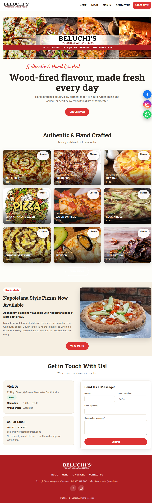
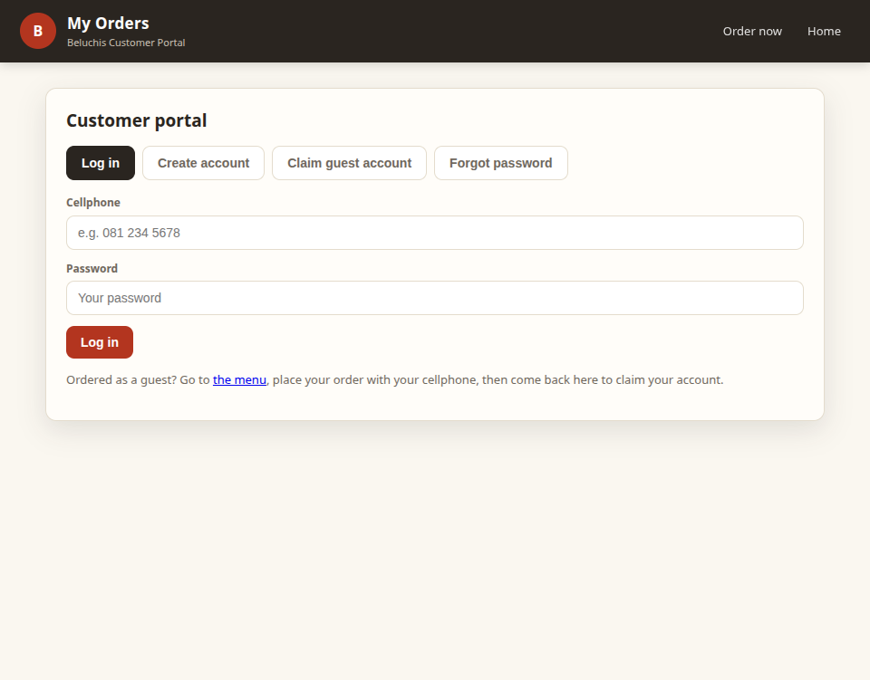

# Beluchi's Pizzas — Customer User Guide

Welcome! This guide explains how to use the Beluchi's Pizzas website to browse our menu, build your order, check out, and track your order. No technical knowledge needed.

**Where we are:** 72 High Street, Q-Square, Worcester, South Africa
**Phone:** 023 347 5447
**Email:** beluchis.worcester@gmail.com
**Open:** daily 10:00 – 21:00 (online orders accepted during opening hours)

---

## 1. The Home page

When you open the website you land on the Home page. Here you will find:

- **Shop status pill** (top right of the contact card) — shows whether we are **Open now** or **Closed — opens 10:00**. When closed, online checkout is paused but you can still browse and build your cart.
- **Specials tiles and banners** — our current deals. Tap any dish photo to add it, or tap "View menu" to see everything.
- **Napoletana section** — info about our 48-hour fermented dough base.
- **Get in Touch card** — address, phone, email, opening hours.
- **Contact form** — send us a message (we reply by email/phone). *No orders by email please — use the order page or WhatsApp.*
- **Social links** at the bottom — Facebook, Instagram, WhatsApp.

Navigation bar (top): **HOME**, **MENU**, **SIGN IN / MY ORDERS**, **CONTACT US**, and the red **ORDER NOW!** button.

---

## 2. The Menu page (ordering)

Tap **MENU** or **ORDER NOW!** to open the menu. Everything you need to order is here.

### 2.1 Browsing
- Dishes are grouped by category (Pizzas, Pastas, Grills, etc.).
- Each dish shows a photo, name, description, available sizes and prices.
- A heart (♡) on a dish lets you save it to your favourites (you need to be logged in).

### 2.2 Choosing a size
- Tap a size button (e.g. *Medium · R95*) to add that size to your cart.
- Use the **+ / −** stepper next to it to set how many you want before adding.
- Some dishes have a **Choose** button instead — these open a customiser where you pick base, extras and toppings.

### 2.3 Customising a dish
When a dish has options (base, extra toppings, seasonal swaps):
1. Tap **Choose**.
2. Pick a size at the top.
3. Choose a base (some are free, some cost extra).
4. Tick any extra toppings you want (price shown).
5. If a topping is out of season, you can swap it for another of the same value at no charge, or remove it.
6. Set the quantity with **+ / −**.
7. Tap **Add to Order**. The price updates as you change options.

### 2.4 Deals and specials
Look for the **Deals** carousel at the top of the menu:
- **Buy-one-get-one (BOGO)** — "Pick 2, pay 1" style deals. Tap **Build your deal**, then choose each pizza and size. The cheapest (or specified) ones are charged.
- **Combo / fixed-price deals** — a set of items for one price. Tap **Add to Order**.
- **Automatic deals** — apply themselves when you add the right items; just shop the category.
- **Pick deals (Buy N get 1 free)** — pick any N pizzas from a category, pay for N−1.

### 2.5 Your cart
- Tap the **Cart** button (top right) to open the cart drawer.
- Change quantities with **+ / −**, or remove a line.
- The total is shown at the bottom.
- A floating bar at the bottom of the screen also shows your item count and total — tap **View full menu** or **Go to checkout**.

---

## 3. Checkout

Tap **Checkout** (in the cart) to start. Checkout has three steps, shown as an accordion — each step must be completed before the next opens.

### Step 1 — Your details
Enter your first name, last name, phone number and optional email.

### Step 2 — Delivery or collection
- Choose **Delivery** or **Collection**.
- **Delivery:** pick a saved location, or tap **+ Add a new location**. Drop a pin on the map (or use "Use my current location") so we can calculate the delivery fee.
  - Free delivery within 3 km on orders from R200.
  - R85 fee up to 10 km.
  - R95 beyond 10 km.
  - No address saved = collection.
- Add any notes (e.g. "call on arrival").

### Step 3 — Payment
- Optional coupon code (enter and the discount applies).
- Choose how to pay:
  - **Cash on delivery**
  - **Card on delivery**
  - **Paid online now** (only if PayGate is enabled)
  - **Pay at counter** (only if enabled)
- Tap **Review order**, check the summary, then confirm.

After you place the order you see an **Order #** and a success message. Keep this number — you can track the order in **My Orders**.

---

## 4. Your account (My Orders portal)

Tap **SIGN IN** (or **MY ORDERS**) in the top bar to open the portal.

### 4.1 Logging in
- Enter your cellphone number and password, then **Log in**.
- If you ordered as a guest before, use **Claim guest account** — enter the cellphone you ordered with, your first name, and choose a password. Your past orders will link to your new account.
- **Forgot password?** — enter your cellphone and first name, then set a new password.
- **Create account** — register with name, cellphone, optional email and a password.

### 4.2 Your dashboard (after login)
- **My details** — view/edit your name, phone and email. Tap "Edit profile" to change.
- **Delivery locations** — save up to 3 spots. Each needs a unique name and a pin on the map. Select one as "Selected for delivery", edit or delete.
- **Offers for you** — personalised coupon codes with expiry and minimum spend. Tap **Copy** to copy the code, then paste it at checkout.
- **Your favourites** — dishes and deals you hearted. Tap **Order** to jump to them, or **Remove**.
- **Order history** — all your orders with status, items, totals and a progress timeline. Tap **Reorder** to add the same items to your cart again.

### 4.3 Order status timeline
Each order shows a progress bar: **Placed → Preparing → Out for delivery → Delivered**. If an order is cancelled, a red strip appears. When payment is still being confirmed you'll see "Awaiting payment".

### 4.4 Notifications
If you allow browser notifications, you'll get a pop-up when an order status changes (checked every 30 seconds while the portal is open).

---

## 5. Tips

- **Closed?** You can still browse the menu and build your cart; checkout opens again at 10:00.
- **Delivery fee** depends on distance from us and the order amount — drop a pin for an accurate fee.
- **Reorder** is the quickest way to repeat a previous order.
- **Favourites** are saved to your account — log in on any device to see them.
- **No orders by email** — please order through the website or WhatsApp.

---

## 6. Contact us

- **Visit:** 72 High Street, Q-Square, Worcester
- **Phone:** 023 347 5447
- **Email:** beluchis.worcester@gmail.com
- **Facebook:** facebook.com/beluchisworcesterpizza
- **Instagram:** @beluchis (see site footer)
- **WhatsApp:** +27 71 461 7381
- **Contact form** on the Home page — we reply during opening hours.

*Beluchi's Pizzas — Authentic & Hand Crafted. © 2026*
