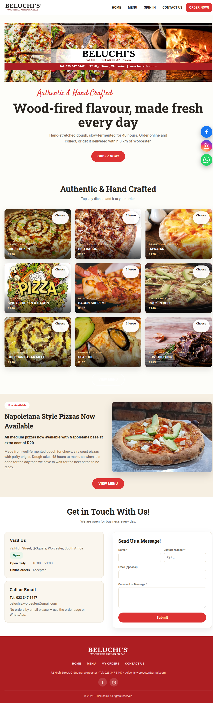
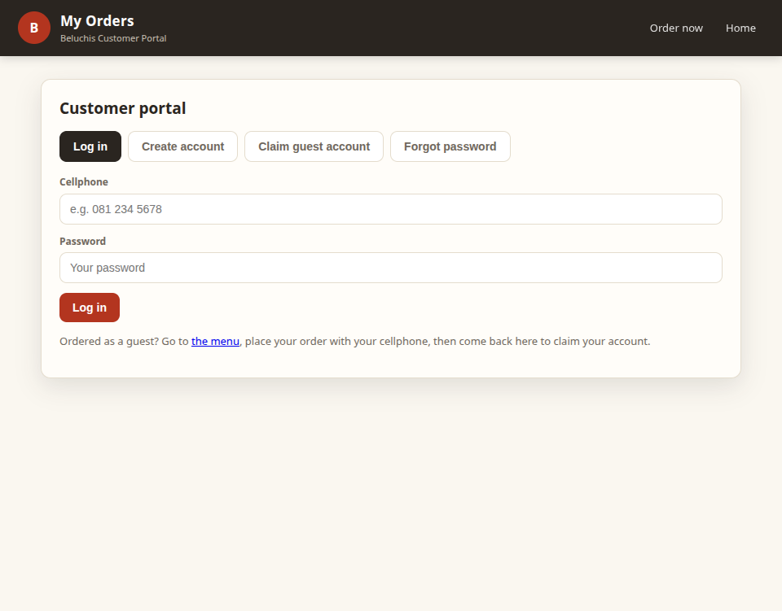

# Beluchi's Pizzas — Kliënt Gebruikersgids

Welkom! Hierdie gids verduidelik hoe om die Beluchi's Pizzas webwerf te gebruik om ons spyskaart te blaai, jou bestelling saam te stel, af te reken en jou bestelling op te spoor. Geen tegniese kennis nodig nie.

**Waar ons is:** 72 High Street, Q-Square, Worcester, Suid-Afrika
**Telefoon:** 023 347 5447
**E-pos:** beluchis.worcester@gmail.com
**Oop:** daagliks 10:00 – 21:00 (aanlyn bestellings tydens oop ure aanvaar)

---

## 1. Die Tuisblad

Wanneer jy die webwerf oopmaak, land jy op die Tuisblad. Hier vind jy:

- **Winkelstatus (pil)** (regs bo in die kontakkaart) — wys of ons **Nou oop** of **Gesluit — oop 10:00** is. Wanneer gesluit, is aanlyn afrekening gepouseer, maar jy kan steeds blaai en jou mandjie bou.
- **Spesiale teëls en baniere** — ons huidige aanbiedinge. Tik op enige gereg-foto om dit by te voeg, of tik "Bekyk spyskaart" om alles te sien.
- **Napoletana-afdeling** — inligting oor ons 48-uur gegiste deegbasis.
- **Kontakkaart** — adres, telefoon, e-pos, oop ure.
- **Kontakvorm** — stuur ons 'n boodskap (ons antwoord per e-pos/telefoon). *Geen bestellings per e-pos nie — gebruik die bestelblad of WhatsApp.*
- **Sosiale skakels** onderaan — Facebook, Instagram, WhatsApp.

Navigasiebalk (bo): **HOME**, **MENU**, **SIGN IN / MY ORDERS**, **CONTACT US**, en die rooi **ORDER NOW!** knoppie.

---

## 2. Die Spyskaartblad (bestel)

Tik **MENU** of **ORDER NOW!** om die spyskaart oop te maak. Alles wat jy nodig het om te bestel is hier.

### 2.1 Blaai
- Geregte word per kategorie gegroepeer (Pizzas, Pastas, Grills, ens.).
- Elke gereg wys 'n foto, naam, beskrywing, beskikbare groottes en pryse.
- 'n Hartjie (♡) op 'n gereg laat jou dit as gunsteling stoor (jy moet ingeteken wees).

### 2.2 Kies 'n grootte
- Tik op 'n grootteknoppie (bv. *Medium · R95*) om daardie grootte by jou mandjie te voeg.
- Gebruik die **+ / −** stapper langs dit om hoeveelheid te stel voor jy byvoeg.
- Sommige geregte het 'n **Choose** knoppie in plaas daarvan — dit open 'n aanpasser waar jy basis, ekstras en toppings kies.

### 2.3 Pas 'n gereg aan
Wanneer 'n gereg opsies het (basis, ekstra toppings, seisoenale ruil):
1. Tik **Choose**.
2. Kies 'n grootte bo.
3. Kies 'n basis (sommige gratis, sommige kos ekstra).
4. Merk enige ekstra toppings wat jy wil hê (prys gewys).
5. As 'n topping buite seisoen is, kan jy dit vir 'n ander van dieselfde waarde ruil teen geen ekstra koste, of verwyder.
6. Stel die hoeveelheid met **+ / −**.
7. Tik **Add to Order**. Die prys werk by soos jy verander.

### 2.4 Aanbiedinge en spesiale
Kyk vir die **Deals**-karrousel boaan die spyskaart:
- **Koop-een-kry-een (BOGO)** — "Kies 2, betaal 1" tipe aanbiedinge. Tik **Build your deal**, kies dan elke pizza en grootte. Die goedkoopste (of gespesifiseerde) word gehef.
- **Kombo / vasteprys-aanbiedinge** — 'n stel items vir een prys. Tik **Add to Order**.
- **Outomatiese aanbiedinge** — pas hulself toe wanneer jy die regte items byvoeg; blaai net die kategorie.
- **Kies-aanbiedinge (Koop N kry 1 gratis)** — kies enige N pizzas uit 'n kategorie, betaal vir N−1.

### 2.5 Jou mandjie
- Tik die **Cart**-knoppie (regs bo) om die mandjie-laai oop te maak.
- Verander hoeveelhede met **+ / −**, of verwyder 'n lyn.
- Die totaal word onderaan gewys.
- 'n Sweefbalk onderaan die skerm wys ook jou itemtelling en totaal — tik **View full menu** of **Go to checkout**.

---

## 3. Afrekening

Tik **Checkout** (in die mandjie) om te begin. Afrekening het drie stappe, as 'n akkordeon — elke stap moet voltooi word voor die volgende oopmaak.

### Stap 1 — Jou besonderhede
Voer jou voornaam, van, telefoonnommer en opsionele e-pos in.

### Stap 2 — Aflewering of afhaal
- Kies **Delivery** of **Collection**.
- **Aflewering:** kies 'n gestoorde ligging, of tik **+ Add a new location**. Laat 'n pen op die kaart val (of gebruik "Use my current location") sodat ons die afleweringsfooi kan bereken.
  - Gratis aflewering binne 3 km op bestellings van R200.
  - R85 fooi tot 10 km.
  - R95 verder as 10 km.
  - Geen adres gestoor = afhaal.
- Voeg enige notas by (bv. "bel by aankoms").

### Stap 3 — Betaling
- Opsionele koeponkode (voer in en die afslag pas toe).
- Kies hoe om te betaal:
  - **Kontant by aflewering**
  - **Kaart by aflewering**
  - **Nou aanlyn betaal** (slegs as PayGate geaktiveer is)
  - **Betaal by toonbank** (slegs as geaktiveer)
- Tik **Review order**, kontroleer die opsomming, bevestig dan.

Na jy bestel het, sien jy 'n **Bestelling #** en 'n suksesboodskap. Hou hierdie nommer — jy kan die bestelling in **My Orders** opspoor.

---

## 4. Jou rekening (My Orders portaal)

Tik **SIGN IN** (of **MY ORDERS**) in die bo-balk om die portaal oop te maak.

### 4.1 Inteken
- Voer jou selfoonnommer en wagwoord in, tik dan **Log in**.
- As jy voorheen as gas bestel het, gebruik **Claim guest account** — voer die selfoon waarmee jy bestel het, jou voornaam, en kies 'n wagwoord in. Jou vorige bestellings sal aan jou nuwe rekening koppel.
- **Forgot password?** — voer jou selfoon en voornaam in, stel dan 'n nuwe wagwoord.
- **Create account** — registreer met naam, selfoon, opsionele e-pos en 'n wagwoord.

### 4.2 Jou dashboard (na inteken)
- **My details** — bekyk/wysig jou naam, telefoon en e-pos. Tik "Edit profile" om te verander.
- **Delivery locations** — stoor tot 3 plekke. Elkeen het 'n naam en 'n pen op die kaart nodig. Kies een as "Selected for delivery", wysig of verwyder.
- **Offers for you** — persoonlike koeponkodes met vervaldatum en minimum besteding. Tik **Copy** om die kode te kopieer, plak dan by afrekening.
- **Your favourites** — geregte en aanbiedinge wat jy hartjie gegee het. Tik **Order** om daarheen te spring, of **Remove**.
- **Order history** — al jou bestellings met status, items, totale en 'n vorderings-tydlyn. Tik **Reorder** om dieselfde items weer by jou mandjie te voeg.

### 4.3 Bestellingstatus-tydlyn
Elke bestelling wys 'n vorderingsbalk: **Placed → Preparing → Out for delivery → Delivered**. As 'n bestelling gekanselleer is, verskyn 'n rooi strook. Wanneer betaling nog bevestig word, sien jy "Awaiting payment".

### 4.4 Kennisgewings
As jy blaaier-kennisgewings toelaat, kry jy 'n opspringer wanneer 'n bestellingstatus verander (elke 30 sekondes nagegaan terwyl die portaal oop is).

---

## 5. Wenke

- **Gesluit?** Jy kan steeds die spyskaart blaai en jou mandjie bou; afrekening open weer om 10:00.
- **Afleweringsfooi** hang af van afstand van ons en die bestelbedrag — laat 'n pen val vir 'n akkurate fooi.
- **Reorder** is die vinnigste manier om 'n vorige bestelling te herhaal.
- **Gunstelinge** word op jou rekening gestoor — teken in op enige toestel om hulle te sien.
- **Geen bestellings per e-pos** — bestel asseblief deur die webwerf of WhatsApp.

---

## 6. Kontak ons

- **Besoek:** 72 High Street, Q-Square, Worcester
- **Telefoon:** 023 347 5447
- **E-pos:** beluchis.worcester@gmail.com
- **Facebook:** facebook.com/beluchisworcesterpizza
- **Instagram:** sien webwerf-voetskrif
- **WhatsApp:** +27 71 461 7381
- **Kontakvorm** op die Tuisblad — ons antwoord tydens oop ure.

*Beluchi's Pizzas — Authentic & Hand Crafted. © 2026*
